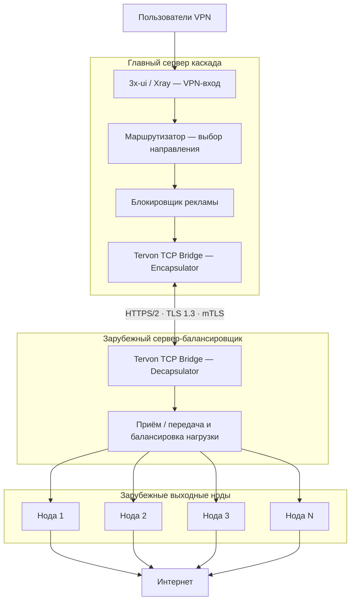

# Tervon TCP Bridge

**Защищённый TCP-мост между серверами через HTTPS/2**

**Linux v1.0.2:** [Выпуск и файлы](https://github.com/tervon-software/Tervon-TCP-Bridge/releases/tag/v1.0.2) · [Установка и контрольная сумма актуального ядра](docs/Server/INSTALL-v1.0.2.ru.md).

**Linux v1.0.1:** [Скачать выпуск](https://github.com/tervon-software/Tervon-TCP-Bridge/releases/tag/v1.0.1) · [Установка на Linux](docs/Server/INSTALL-v1.0.1.ru.md) · [Что нового](docs/Server/RELEASE_NOTES_v1.0.1.ru.md).

Tervon TCP Bridge соединяет два удалённых участка TCP-сети через один защищённый канал. Он принимает обычное TCP-подключение на одной машине, переносит его данные по HTTP/2 поверх TLS 1.3 и передаёт их назначенному сервису на другой машине.

Мост создан для инфраструктуры Tervon VPN, но не привязан к конкретному VPN-протоколу. Для него VLESS, Trojan, Shadowsocks или другой TCP-сервис — просто двунаправленный поток байтов. Расшифровывать или разбирать этот поток самому мосту не требуется.

**Состояние проекта:** основная реализация завершена и используется в действующем маршруте Tervon VPN. Дальнейшая работа — эксплуатационное сопровождение и развитие по отдельным задачам.

## Почему мы создали Tervon TCP Bridge

Мы разрабатывали Tervon VPN как сеть с российской точкой входа и зарубежными выходными серверами. В ноябре 2026 года столкнулись с последовательной потерей доступности зарубежных узлов из России: прямые подключения VLESS TCP и VLESS XHTTP переставали работать, хотя часть соединений Hysteria2 продолжала функционировать. Сложность была не в управлении пользователями, а в устойчивости межсерверного соединения и зависимости от доступности отдельных зарубежных адресов.

Поэтому мы решили отделить **VPN-протокол пользователя** от **транспорта между нашими серверами**. Так появился Tervon TCP Bridge: самостоятельная программа, которая переносит двунаправленные TCP-потоки по HTTP/2 поверх TLS 1.3 с взаимной аутентификацией сертификатами. На принимающей стороне можно разрешить строго определённые TCP-сервисы.

Это инженерное решение для нашей инфраструктуры, а не обещание обхода любых сетевых ограничений. Использование HTTPS/2 само по себе не гарантирует доступности канала в любой сети.

## Зачем отдельный мост, если есть 3x-ui?

**3x-ui — панель управления Xray.** Через неё можно настраивать пользователей, протоколы, входящие и исходящие соединения, в том числе строить межсерверные маршруты средствами Xray. Мы не утверждаем, что такие маршруты невозможно сделать без Tervon TCP Bridge.

Наш Bridge решает более узкую задачу: он работает **отдельным процессом**, принимает обычное TCP-соединение и передаёт его удалённому TCP-сервису. Он не знает UUID пользователей VLESS, не управляет подписками и не разбирает содержимое VPN-трафика. Таким образом, Xray и панель отвечают за VPN, а Bridge — за выбранный межсерверный TCP-транспорт.

Это даёт нам возможность независимо управлять сертификатами моста, разрешёнными backend и жизненным циклом транспорта. За эту независимость приходится платить дополнительным компонентом и настройкой двух серверов. Bridge нужен не каждому владельцу 3x-ui: если штатная маршрутизация Xray полностью решает задачу, отдельный мост необязателен.

## Совместимость с панелями

| Панель или окружение | Состояние |
| --- | --- |
| **3x-ui + Xray-core** | **Подключено и испытано** в инфраструктуре Tervon VPN; подтверждена передача реального TCP-трафика |
| **Remnawave + Xray-core** | **Потенциально совместимо**, но интеграция Tervon TCP Bridge с Remnawave нами не испытывалась; работоспособность конкретной конфигурации пока не гарантируется |
| **Другие TCP-сервисы** | Архитектурно возможны, если обе стороны корректно принимают TCP-поток; конкретные интеграции требуют проверки |

Remnawave тоже поддерживает межсерверную маршрутизацию средствами Xray. Tervon TCP Bridge не является заменой этой функции; это независимый транспорт, который при подходящей конфигурации может работать рядом с Xray, управляемым Remnawave.

**Область подтверждённой совместимости:** работающий TCP-маршрут с 3x-ui/Xray. Поддержку всех вариантов настроек 3x-ui, Remnawave или всех VPN-протоколов мы не заявляем.

## Как это работает

```text
Клиентское приложение
        │
        ▼
Локальный TCP-сервис (например, Xray)
        │ TCP
        ▼
Encapsulator — Tervon TCP Bridge
        │
        │ HTTPS/2 + TLS 1.3 + взаимная аутентификация (mTLS)
        │
        ▼
Decapsulator — Tervon TCP Bridge
        │ TCP, только к разрешённому backend
        ▼
Удалённый TCP-сервис (например, Xray)
        │
        ▼
Дальнейшая маршрутизация / Интернет
```

**Encapsulator** работает рядом с локальным сервисом. Он принимает TCP-подключения на заданном адресе, устанавливает защищённое соединение с удалённой стороной и передаёт данные в обе стороны.

**Decapsulator** принимает соединение, проверяет сертификат клиента и его право использовать запрошенный сервис, после чего соединяется с заранее заданным backend. Клиент не может самостоятельно назначить произвольный адрес назначения.

Мост не вмешивается в содержимое передаваемых данных. Каждая TCP-сессия обслуживается независимо; несколько сессий могут работать параллельно. Закрытие направления передачи TCP (half-close) также обрабатывается мостом.

## Философия проекта

**Простая задача — понятная реализация.** Мы не создаём собственный VPN-протокол, не подменяем Xray и не дублируем его функции. Bridge предоставляет отдельный транспортный уровень.

**Безопасность по умолчанию.** Используются стандартные механизмы TLS 1.3, взаимная проверка сертификатов и разрешения по идентификатору клиента. Удалённые адреса определяются администратором сервера, а не входящим запросом.

**Управляемость.** У каждой стороны свой конфигурационный файл. Фиксированная квота TCP-сессий по умолчанию отключена (`0`), и количество клиентов не ограничивается произвольным порогом. Ресурсы серверов и операционной системы остаются конечными.

**Независимость компонентов.** Bridge не требует изменения внутреннего формата VLESS, Trojan или другого TCP-протокола. Достаточно, чтобы на обоих концах существовали подходящие TCP-сервисы.

**Аккуратная эксплуатация.** Разработка, испытания и обновления отделены от работающих служб. Версии бинарников контролируются по SHA-256, а конфигурации и закрытые ключи не публикуются.

## Что умеет Bridge

- Передавать двунаправленный TCP-поток через HTTPS/2 и TLS 1.3.
- Проверять сертификаты обеих сторон (mTLS).
- Разрешать клиентам только назначенные им сервисы.
- Направлять трафик только к backend из конфигурации Decapsulator.
- Обслуживать параллельные TCP-соединения без фиксированной программной квоты сессий в конфигурации v1.0.1.
- Работать рядом с Xray и другими приложениями, использующими TCP.
- Обрабатывать штатное завершение соединений, half-close и сетевые сбои.

Bridge передаёт **TCP**. Он не является отдельной реализацией UDP, WireGuard или Hysteria2. Эти технологии могут присутствовать в общей инфраструктуре как самостоятельные внешние компоненты.

## Каскадная архитектура Tervon VPN

Мы разделяем задачи между двумя уровнями инфраструктуры:

- **Главный сервер каскада** — единственная точка входа пользователей. На нём работают VPN-сервис (3x-ui / Xray), **маршрутизатор трафика** и **блокировщик рекламы**. Он выбирает нужное направление и передаёт TCP-поток в Encapsulator.
- **Зарубежный сервер-балансировщик** — промежуточный **приёмо-передающий узел с балансировкой нагрузки**. На нём работает Decapsulator и механизм распределения соединений по зарубежным выходным нодам. Он не выполняет функции пользовательской VPN-панели, рекламного фильтра или главного маршрутизатора.



Схема показывает **логические функции**: рекламная фильтрация применяется на главном сервере, а балансировщик только принимает, передаёт и распределяет нагрузку. Tervon TCP Bridge обеспечивает защищённый **TCP-участок между главным сервером и зарубежным балансировщиком**. Распределение между выходными нодами обеспечивает отдельный механизм балансировки, а не сам Bridge.

**Статус испытаний:** работа TCP-моста с 3x-ui/Xray и реальным трафиком подтверждена. Схема всего каскада с несколькими зарубежными нодами описывает целевую архитектуру; отдельное испытание всех её компонентов здесь не заявляется.

## Скачать и установить

**Межсерверный Bridge:** [установка и выбор ролей на двух Linux-серверах](docs/Server/INSTALL-LINUX-PAIR.ru.md).

**Новая установка Android Bridge M6:** [одна команда для native и Docker](docs/Server/INSTALL-M6-UNIFIED.ru.md).

**Поддерживаемый выпуск: Linux v1.0.1, amd64.** Для работы нужны два Linux-сервера с systemd: один в роли Encapsulator (client), второй в роли Decapsulator (server).

### Клонировать репозиторий

Используйте SSH-доступ к GitHub:

```bash
git clone git@github.com:tervon-software/Tervon-TCP-Bridge.git
cd Tervon-TCP-Bridge
git fetch --tags origin
git checkout --detach v1.0.1
```

Если нужен только исполняемый файл, клонирование не требуется: готовый бинарник `tervon-bridge-linux-amd64` и `SHA256SUMS` доступны в [релизе v1.0.1](https://github.com/tervon-software/Tervon-TCP-Bridge/releases/tag/v1.0.1). Проверяйте SHA256 до установки.

### Установка на два новых сервера

Подробное руководство: **[Установка Tervon TCP Bridge v1.0.1](docs/Server/INSTALL-v1.0.1.ru.md)**. Установщик проверяет точный SHA релизного бинарника, создаёт файлы и образцы JSON, но **не запускает сервис автоматически**. Настройка собственной PKI (TLS 1.3/mTLS) и разрешённых маршрутов обязательна; не публикуйте закрытые ключи.

```bash
# На сервере с локальными TCP-подключениями
sudo bash install/install-bridge.sh install client

# На принимающем сервере
sudo bash install/install-bridge.sh install server
```

После подготовки сертификатов и файлов `client.json` / `server.json` выполните `activate` для соответствующей роли, как описано в инструкции. **Не используйте этот установщик для обновления уже работающего Bridge:** он намеренно отказывается перезаписывать действующую установку.

### Документация для пользователей

- [Установка v1.0.1 и первоначальная настройка](docs/Server/INSTALL-v1.0.1.ru.md)
- [Параметры конфигурации и интеграция с Xray](docs/Server/CONFIGURATION.ru.md)
- [Диагностика и типовые ошибки](docs/Server/TROUBLESHOOTING.ru.md)
- [Заметки к выпуску v1.0.1](docs/Server/RELEASE_NOTES_v1.0.1.ru.md)
- [Пример client JSON](examples/client.json) и [пример server JSON](examples/server.json)

## Исходный код и условия использования

Этот публичный репозиторий содержит исходный код TCP Bridge в каталоге [`prototype/`](prototype/), тесты, установщик и инструкции. Имя каталога историческое; статус программного обеспечения определяется выпущенной версией и проверками, а не названием директории. **Чтобы получить исходники именно версии v1.0.1, используйте тег `v1.0.1`**, а не произвольный HEAD основной ветки.

**Ядро Bridge лицензировано по [GNU AGPL версии 3](LICENSE) (`AGPL-3.0-only`).** Лицензия распространяется на собственный исходный код ядра в [`prototype/`](prototype/) и изменения ядра, которые накладывают [`apply-to-release-source.py`](integrations/android-ingress/runtime-acl/apply-to-release-source.py) и [`apply-runtime-policy-to-release-source.py`](integrations/android-ingress/runtime-acl/apply-runtime-policy-to-release-source.py) в этой ветке.

Самостоятельные компоненты, включая Registrar и приложение TervonVPN DPI, не получают лицензию AGPLv3 этим файлом. Для сторонних компонентов действуют их собственные условия. При распространении сборки со встроенным ядром учитывайте условия лицензии ядра.

Не включайте закрытые конфигурации, реальные адреса сервисов и приватные ключи в issues или pull requests.

---

**Tervon TCP Bridge** — отдельный защищённый транспорт для инфраструктуры, в которой важно контролировать, как именно TCP-сервисы соединяются между серверами.
